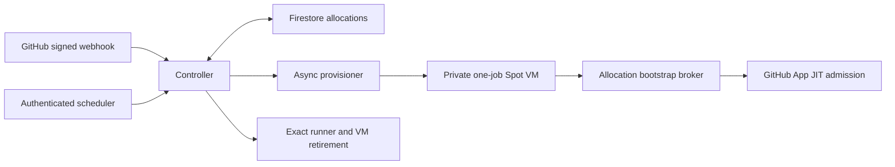

# Architecture

The supported unit is one managed VM, one ephemeral runner and one job. A trusted, explicitly configured repository and a dedicated routing label own admission. Multi-user batching, Docker shared-host isolation, public-fork jobs and arbitrary hostile workloads are outside this profile.

## Allocation lifecycle

1. The webhook verifies the HMAC signature over the exact raw request body before parsing or changing durable state. Repository and requested/registered labels must match the configured allowlist.
2. Firestore identifies an allocation by repository, run, job and attempt. Transactions reserve capacity before asynchronous provisioning. Duplicate deliveries and ambiguous submissions cannot bypass the capacity limit.
3. A distinct provisioning identity submits a private Spot VM from the configured template. A build acceptance response does not prove a VM exists or a job ran.
4. The worker proves its managed-instance identity to an allocation-bound bootstrap broker. The controller holds GitHub App credentials and releases the JIT configuration to the matching claim/incarnation. The worker never receives the App key, a management PAT or controller credentials.
5. Authenticated job observations associate the actual dispatched job with the issued runner. Scheduled bounded recovery replays canonical waiting demand fairly and reconciles uncertain provider outcomes. Persisted demand is revalidated before retry rather than reconstructed from an untrusted request.
6. Retirement requires sufficient exact-incarnation evidence, a stable runner inventory and safe stop/delete conditions. After terminal-job evidence, verified worker drain/stop acknowledgements and ephemeral-runner absence, the controller records a single-use named stop intent, submits it at most once, and checks the provider state before deletion. Ambiguous mutation outcomes remain preserved; retry does not authorize duplicate stop/delete submissions. Capacity is released only after cloud absence is established. Unknown outcomes preserve the reservation.

## Identity boundaries

| Identity | Responsibility | Boundary |
|---|---|---|
| Controller | State, signature-secret/App-key reads, bootstrap verification, GitHub operations and retirement | Management credentials remain here |
| Provisioner | Managed VM creation and reconciliation | May attach only the selected worker identity |
| Scheduler/cleanup caller | Authenticated controller invocation | Does not directly delete VMs or deregister runners |
| Worker | One job and allocation-bound bootstrap/control | No Compute management, authoritative Firestore writes, App key or Docker socket |
| Function build identity | Build the deployment artifact | Operator-supplied, distinct from worker |

The worker service runs without restart, sudo privileges or a shared Docker socket. A worker exit is not proof of VM shutdown. Spot interruption, failed shutdown and ambiguous submissions can retain cost and capacity charges until reconciliation.

## Code boundaries

`cloud-functions/webhook-handler/` contains signature admission, durable allocation, managed-identity verification, App runner adapters and controller composition. `cloud-functions/cleanup-function/` contains retirement and lifecycle dispatch plus the canonical conservative cleanup helper. `startup/` contains the one-job bootstrap/control service. `packaging/` assembles the runtime closure. `terraform/` supplies resources, IAM and non-secret environment outputs.

Tests inject clients and transport seams to exercise negative identity, retry, cancellation, association and retirement paths. They do not prove effective live IAM, provider JIT lifetime, actor quiescence, network reachability or a production isolation boundary. Qualification controls are deliberately explicit; deployment must not infer them from a green CI run.
